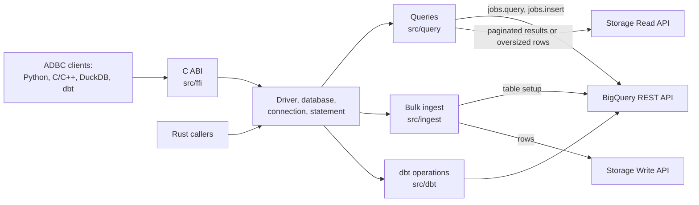

# Architecture

Public behavior is documented in the [driver reference](REFERENCE.md).

## Overview

The Rust library implements the `adbc_core` driver, database, connection and statement traits.
`src/ffi` exports them through the C ABI; no other module depends on that interface.

`src/runtime.rs` bridges blocking ADBC calls to asynchronous Google clients. Each Rust driver owns
a Tokio runtime shared by its handles and readers. The C ABI keeps one driver for the process;
releasing its handles does not stop the runtime, so the shared library must remain loaded. A
`fork` child loses the runtime's workers, so each database it opens gets a new runtime.

## Running a query

1. `src/statement.rs` collects the SQL, options and bound parameters. `src/parameters` converts
   Arrow parameters to BigQuery parameter types.
2. `src/query/plan.rs` selects `jobs.query` for ordinary queries, allowing short queries to return
   without creating a job. Dry runs and job-only settings, such as a destination table or batch
   priority, select `jobs.insert`. `src/query/direct` handles submission, polling and query
   reissues; `src/rest/jobs.rs` handles transport retries and recovery after a lost response.
3. Once the query completes, `src/query/reader.rs` selects a reader from its first result page.
   A complete page is decoded from REST JSON. A continuation token or a row too large for REST
   selects Storage Read. If Storage Read is disabled or a permitted fallback applies, the driver
   pages through REST instead; a row over REST's limit still fails. The
   [reference](REFERENCE.md#reading-large-results-through-the-storage-read-api) lists fallback
   conditions.
4. Both paths produce the same Arrow schema. `src/types/schema.rs` derives it from BigQuery's REST
   schema. `src/rows` decodes JSON rows against it, and `src/storage_read` reshapes Arrow batches
   into it.
5. `src/pipeline.rs` hands batches from the asynchronous producers to the synchronous Arrow
   reader, with budgets for buffered batches and bytes. Dropping the reader cancels the work.
   Complete pages of at most 32 rows and 4 KiB skip the pipeline and convert on the first read;
   empty results need no conversion.

`src/arrow_ipc_bigquery` is a small Arrow IPC codec covering only what BigQuery sends and accepts,
including LZ4 frames. It replaces the general-purpose `arrow-ipc` crate to keep the library small
([BINARY-SIZE.md](BINARY-SIZE.md)), and it is a fuzzing target because it parses network input.

## Bulk ingest

`src/ingest` validates the target and the Arrow schema, prepares the table for the ingest mode,
then writes through the Storage Write API:

1. `src/ingest/target.rs` and `src/ingest/schema` resolve the table and check that the bound schema
   fits it.
2. `src/ingest/align` fills in an append's unspecified types and limits from the destination
   table. `src/ingest/normalize` then converts Arrow input to the shapes BigQuery accepts, in
   windows sized to stay under the request limit.
3. `src/ingest/write` appends the batches, encoded by `src/arrow_ipc_bigquery`, to a pending stream
   and commits it, so the rows become visible together.

Table preparation and the stream commit are separate operations. In particular, `replace` can
remove the old rows before a later step fails; the [ingest reference](REFERENCE.md#bulk-ingest)
describes the failure behavior for each mode.

## Other subsystems

| Path | Responsibility |
| --- | --- |
| `src/config`, `src/driver/uri.rs` | Validate options, URIs, credentials and endpoints, including which endpoint overrides may receive credentials ([endpoint rules](REFERENCE.md#endpoint-overrides)). |
| `src/options` | Option keys and values. `src/python_options.rs` generates the Python enums from them. |
| `src/clients.rs` | Lazily created REST and Storage clients that share one configuration snapshot. |
| `src/rest` | The REST client, wire models and retry rules. `src/rest/rejection` classifies BigQuery's errors. |
| `src/connection` | Metadata: `GetObjects`, `GetTableSchema`, `GetStatistics` and `GetInfo`. |
| `src/transaction.rs` | Manual-commit state, shared by a connection and its statements, on top of BigQuery sessions. |
| `src/cancellation` | Tracking and cancelling the active operation, locally and remotely. |
| `src/error` | Maps failures to ADBC statuses, SQLSTATEs and error details. |
| `src/types` | BigQuery and Arrow type mappings, including decimals and temporal values. |
| `src/dbt` | Option-only operations for dbt 2.0, such as table copies, Python models and CSV seeds. `dbt::statement` owns their options and mode transitions; operation modules stay private ([DBT.md](DBT.md)). |
| `src/diag.rs` | Opt-in diagnostics on standard error, for events with no ADBC caller to report to. |

## Design constraints

- `Cargo.toml` sets per-dependency optimization levels; [BINARY-SIZE.md](BINARY-SIZE.md) records
  their effect on the shared library.
- **Unsafe code stays in the `ffi` module.** The crate denies `unsafe_code` everywhere else. The
  export layer catches panics before they cross the C ABI and reports them as ADBC errors.
- **Option values can be secrets.** Validation errors omit them, except endpoint hosts and ports.
  Row-decoding errors omit cell values.
- **Backpressure limits queued work.** Result readers have separate budgets for completed
  batches and pending REST conversion inputs; each allows one oversized batch to proceed.
  Response pages, conversions in progress and batches returned to the caller are outside the
  completed-batch budget, so it is not a process memory limit. Ingestion converts one
  request-sized window at a time. See the
  [buffering rules](REFERENCE.md#reading-large-results-through-the-storage-read-api).

## Tests

| Path | Contents |
| --- | --- |
| `src/**/tests.rs` | Unit and mock-server tests, beside the code. These run offline. |
| `tests/bigquery/` | Rust tests against real BigQuery, ignored by default. |
| `tests/clients/` | Drivers for the client suites in `integration/`. |
| `integration/` | ADBC C++ validation, Driver Foundry, DuckDB and dbt projects. |
| `python/tests/` | The Python package, its build backend and the installed wheel. |
| `fuzz/` | Fuzz targets for the Arrow IPC and REST decoders. |
| `benches/` | Microbenchmarks ([PERFORMANCE.md](PERFORMANCE.md)). |

[CONTRIBUTING.md](../CONTRIBUTING.md) covers how to run them.
