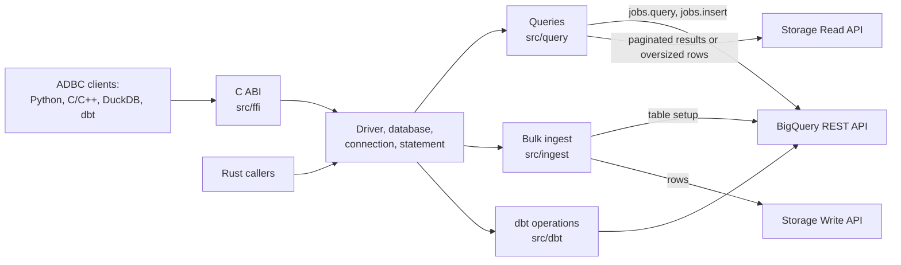

# Architecture

Public behavior is documented in the [driver reference](REFERENCE.md).

## Overview

The library implements the `adbc_core` driver, database, connection and statement traits; `src/ffi`
exports them through the C ABI, and no other module depends on it. `src/runtime.rs` bridges blocking
ADBC calls to the asynchronous Google clients on a Tokio runtime that each driver shares with its
handles and readers. The C ABI keeps one driver for the process, so its runtime outlives released
handles and the shared library must stay loaded; a `fork` child gets a new runtime per database.

## Running a query

1. `src/statement.rs` collects the SQL, options and bound parameters; `src/parameters` converts
   Arrow parameters to BigQuery parameter types.
2. `src/query/plan.rs` selects `jobs.query`, or `jobs.insert` for dry runs and job-only settings.
   `src/query/direct` handles submission, polling and reissues; `src/rest/jobs.rs` handles
   transport retries and recovery after a lost response.
3. `src/query/reader.rs` selects a reader from the first result page: REST JSON for a complete
   page, otherwise Storage Read, with REST paging as the fallback.
4. Both paths produce the Arrow schema `src/types/schema.rs` derives from BigQuery's REST schema:
   `src/rows` decodes JSON rows into it and `src/storage_read` reshapes Arrow batches to it.
5. `src/pipeline.rs` hands batches from the asynchronous producers to the synchronous Arrow reader
   under batch and byte budgets; dropping the reader cancels the work. Complete pages of at most 32
   rows and 4 KiB skip the pipeline and convert on the first read.

`src/arrow_ipc_bigquery` is a small Arrow IPC codec, including LZ4 frames, covering only what
BigQuery sends and accepts. It replaces `arrow-ipc` to keep the library small
([BINARY-SIZE.md](BINARY-SIZE.md)) and is fuzzed because it parses network input.

## Bulk ingest

1. `src/ingest/target.rs` and `src/ingest/schema` resolve the table and check that the bound schema
   fits it, and the table is prepared for the ingest mode.
2. `src/ingest/align` fills in an append's unspecified types and limits from the destination table;
   `src/ingest/normalize` converts Arrow input to the shapes BigQuery accepts, in request-sized
   windows.
3. `src/ingest/write` appends the batches, encoded by `src/arrow_ipc_bigquery`, to a Storage Write
   pending stream and commits it, so the rows become visible together. Table preparation is a
   separate operation, so a failed `replace` can already have removed the old rows.

## Other modules

| Path | Responsibility |
| --- | --- |
| `src/config`, `src/driver/uri.rs` | Options, URIs, credentials and endpoint trust. |
| `src/options` | Option keys and values; `src/python_options.rs` generates the Python enums from them. |
| `src/identifiers.rs`, `src/duration.rs` | Identifier validation and quoting; Go-style durations. |
| `src/clients.rs` | Lazily created REST and Storage clients sharing one configuration snapshot; a closed database's REST connection pool passes to the next database on its runtime (`src/rest/client.rs`). |
| `src/rest` | REST client, wire models and retry rules; `src/rest/rejection` classifies BigQuery's errors. |
| `src/connection` | Metadata: `GetObjects`, `GetTableSchema`, `GetStatistics` and `GetInfo`. |
| `src/transaction.rs` | Manual-commit state over BigQuery sessions, shared by a connection and its statements. |
| `src/cancellation` | Tracking and cancelling the active operation, locally and remotely. |
| `src/error` | ADBC statuses, SQLSTATEs and error details. |
| `src/types`, `src/schema_metadata.rs` | BigQuery and Arrow type mappings; the public schema metadata keys. |
| `src/dbt` | dbt 2.0 option-only operations ([DBT.md](DBT.md)); `dbt::statement` owns their options and mode transitions, and operation modules stay private. |
| `src/diag.rs` | Opt-in diagnostics on standard error, for events with no ADBC caller to report to. |

## Design constraints

- Unsafe code stays in `src/ffi`; the crate denies `unsafe_code` elsewhere. The export layer turns
  panics into ADBC errors before they cross the C ABI.
- Option values can be secrets: validation errors omit them, except endpoint hosts and ports, and
  row-decoding errors omit cell values.
- `Cargo.toml` sets per-dependency optimization levels; [BINARY-SIZE.md](BINARY-SIZE.md) records
  their effect.

## Tests

| Path | Contents |
| --- | --- |
| `src/**/tests.rs` | Offline unit and mock-server tests, beside the code. |
| `tests/bigquery/` | Rust tests against real BigQuery, ignored by default. |
| `tests/clients/` | Drivers for the client suites in `integration/`: ADBC C++ validation, Driver Foundry, DuckDB and dbt. |
| `python/tests/` | The Python package, its build backend and the installed wheel. |
| `fuzz/` | Fuzz targets for the Arrow IPC and REST decoders. |
| `benches/` | Microbenchmarks ([PERFORMANCE.md](PERFORMANCE.md)). |

[CONTRIBUTING.md](../CONTRIBUTING.md) covers how to run them.
