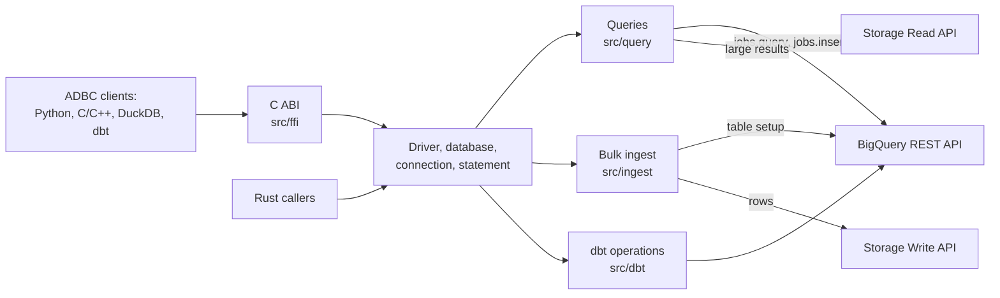
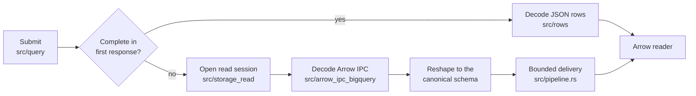

# Architecture

How the driver is put together, for anyone reading or changing the code. Option behavior and
guarantees are in the [driver reference](REFERENCE.md).

## Overview

The driver is an ordinary Rust library that implements the `adbc_core` traits. `BigQueryDriver`
creates a `BigQueryDatabase`, which creates `BigQueryConnection`s, which create
`BigQueryStatement`s. The C ABI in `src/ffi` is a translation layer on top of those types: nothing
outside it knows the driver is exported over C.

ADBC is a blocking API and the Google clients are asynchronous. `src/runtime.rs` holds one Tokio
runtime shared by the driver hierarchy and bridges the two. The ADBC objects block on it, and
result readers receive batches from tasks running on it.

## Running a query

1. `src/statement.rs` collects the SQL, options and bound parameters. `src/parameters` converts
   Arrow parameters to BigQuery parameter types.
2. `src/query` submits the query. Ordinary queries use `jobs.query`, which lets short queries
   return their rows without creating a job. Dry runs and options that need a job use
   `jobs.insert`. Submission, polling and recovery after a lost response are in `src/query/direct`.
3. `src/query/reader.rs` picks where the rows come from once the query completes. A result that
   fits in the first response is decoded from REST JSON. A paginated result, or a row too large
   for REST, is read through Storage Read. If Storage Read is disabled or unavailable, the driver
   pages through REST instead.
4. Both paths produce the same Arrow schema. `src/types/schema.rs` derives it from BigQuery's REST
   schema. `src/rows` decodes JSON rows against it, and `src/storage_read` reshapes Arrow batches
   into it, so a client cannot tell which path served a query.
5. `src/pipeline.rs` hands batches from the asynchronous producers to the synchronous Arrow
   reader, with bounds on buffered batches and bytes. Dropping the reader cancels the work. Small
   complete results skip it and convert lazily.

`src/arrow_ipc_bigquery` is a small Arrow IPC codec covering only what BigQuery sends and accepts,
including LZ4 frames. It replaces the general-purpose `arrow-ipc` crate to keep the library small
([BINARY-SIZE.md](BINARY-SIZE.md)), and it is a fuzzing target because it parses network input.

## Bulk ingest

`src/ingest` validates the target and the Arrow schema, prepares the table for the ingest mode,
then writes through the Storage Write API:

1. `src/ingest/target.rs` and `src/ingest/schema` resolve the table and check that the bound schema
   fits it.
2. `src/ingest/align` fills in an append's unspecified types and limits from the destination
   table. `src/ingest/normalize` then converts Arrow input to the shapes BigQuery accepts, in
   windows sized to stay under the request limit.
3. `src/ingest/write` appends the batches, encoded by `src/arrow_ipc_bigquery`, to a pending stream
   and commits it, so the rows become visible together.

## Other subsystems

| Path | Responsibility |
| --- | --- |
| `src/config`, `src/driver/uri.rs` | Options and URIs into validated credentials and endpoints, including the rules that keep credentials on Google hosts. |
| `src/options` | Option keys and values. `src/python_options.rs` generates the Python enums from them. |
| `src/clients.rs` | Lazily created REST and Storage clients that share one configuration snapshot. |
| `src/rest` | The REST client, wire models and retry rules. `src/rest/rejection` classifies BigQuery's errors. |
| `src/connection` | Metadata: `GetObjects`, `GetTableSchema`, `GetStatistics` and `GetInfo`. |
| `src/transaction.rs` | Manual-commit state, shared by a connection and its statements, on top of BigQuery sessions. |
| `src/cancellation` | Tracking and cancelling the active operation, locally and remotely. |
| `src/error` | Maps failures to ADBC statuses, SQLSTATEs and error details. |
| `src/types` | BigQuery and Arrow type mappings, including decimals and temporal values. |
| `src/dbt` | Option-only operations for dbt-core 2.0, such as table copies, Python models and CSV seeds ([DBT-CORE.md](DBT-CORE.md)). |
| `src/diag.rs` | Opt-in diagnostics on standard error, for events with no ADBC caller to report to. |

## Design constraints

- **Library size matters.** The driver is loaded into other processes, so dependencies and their
  features are chosen deliberately, and `Cargo.toml` sets an optimization level per dependency.
  [BINARY-SIZE.md](BINARY-SIZE.md) records the measurements.
- **Unsafe code stays in `src/ffi`.** The crate denies `unsafe_code` everywhere else. Every entry
  point catches panics and turns them into ADBC errors.
- **Errors never echo credentials or row contents.** Credentials can arrive under any option key,
  so option errors leave values out.
- **Memory stays bounded.** Result delivery limits buffered bytes and batches, and ingestion
  converts one request-sized window at a time.

## Tests

| Path | Contents |
| --- | --- |
| `src/**/tests.rs` | Unit and mock-server tests, beside the code. These run offline. |
| `tests/bigquery/` | Rust tests against real BigQuery, ignored by default. |
| `tests/clients/` | Drivers for the client suites in `integration/`. |
| `integration/` | ADBC C++ validation, Driver Foundry, DuckDB and dbt projects. |
| `python/tests/` | The Python package, its build backend and the installed wheel. |
| `fuzz/` | Fuzz targets for the Arrow IPC and REST decoders. |
| `benches/` | Microbenchmarks ([PERFORMANCE.md](PERFORMANCE.md)). |

[CONTRIBUTING.md](../CONTRIBUTING.md) covers how to run them.
